  

# 🤖 Awesome AI Agent Skills & Prompt Engineering

  
  
  
  
  
  

> 🌟 A curated directory of leading SaaS platforms and open-source frameworks for **AI Agent Skills (`SKILL.md`)**, **Prompt Engineering & Versioning**, **Automated Prompt Optimization**, **LLMOps**, and **Agent Evaluation & Red-Teaming Suites**.

📅 **Last updated: November 2026**

---

## 🏛️ Overview & Architecture

Modern AI agent architectures demand modular, maintainable, and verifiable prompt systems. This repository aggregates tools across the generative AI and agentic workflow lifecycle:
- 🧩 **Agent Skill Systems (`SKILL.md`)**: Reusable capability packs providing progressive context disclosure, tool definitions, and structured workflows across Claude Code, Cursor, Codex, and Gemini CLI.
- 🏷️ **Enterprise Prompt Management & Versioning**: Production-grade prompt CMS platforms enabling visual branching, environment release tagging (`production`, `staging`), prompt caching, and latency tracking.
- ⚡ **Automated Prompt Compilers & Optimizers**: Algorithmic prompt tuning frameworks (e.g., `DSPy`, `TextGrad`) that replace fragile manual prompt strings with automated teleprompters and textual gradients.
- 📐 **Structured Outputs & Schema Adherence**: Type-safe generation engines enforcing JSON schema, Pydantic constraints, and context-free grammars (CFGs).
- 🛡️ **Evaluation, Observability & Red-Teaming**: Multi-agent test harnesses, LLM-as-a-judge CI/CD regressions, and adversarial security scanning.

---

## 📑 Table of Contents

- [📊 Sector Overview & Market Dynamics](#-sector-overview--market-dynamics)
- [☁️ SaaS & Hosted Platforms](#️-saashosted-platforms)
- [🐙 Open-Source GitHub Projects](#-open-source-github-projects)
- [🛠️ Recommended Stacks & Workflows](#️-recommended-stacks--workflows)
- [🤝 How to Contribute](#-how-to-contribute)
- [💖 Support](#-support)
- [📈 Star History](#-star-history)
- [⚖️ Disclaimer](#️-disclaimer)

---

## 📊 Sector Overview & Market Dynamics

The LLMOps and prompt engineering market is projected at **$3.8B–$5.2B in 2026** (scaling past $8B by 2029 at an estimated CAGR of 25–35%), fueled by widespread enterprise transition from single-prompt chat interfaces to autonomous, multi-agent production pipelines. The sector remains **highly fragmented** rather than winner-take-all: the rapid emergence of reasoning models, agent context standards (`SKILL.md`), and decoupled architectures prevents any single vendor from monopolizing the stack, driving strong co-existence between modular open-source frameworks and enterprise governance platforms. 🚀

---

## ☁️ SaaS/Hosted Platforms

| 🏢 Platform | 💰 Company Scale (Valuation / Funding) | 🏷️ Pricing (Starting Paid Tier) | 🎁 Free Tier / Trial Limit | ⚙️ Key Capabilities |
| :--- | :--- | :--- | :--- | :--- |
| **[LangSmith (LangChain)](https://langchain.com)** | **$1.25B+ Valuation** ($160M+ funded, $16M+ ARR) | **$39 / user / month** (Plus Plan; $0.005/trace over base) | **Free Forever (Developer Tier)**: 1 user, 5,000 base traces/month, 14-day retention | Enterprise prompt playground, prompt versioning hub, trace debugging, and automated eval test suites |
| **[Braintrust](https://braintrust.dev)** | **$800M Valuation** ($121M funded) | **$249 / month** (Pro Plan; includes 5 GB data & 50k scores) | **Free Forever (Starter Tier)**: Unlimited users, 1 GB data/month, 10,000 scores/month, $10 gateway credits/month, 14-day retention | End-to-end AI evaluation platform, side-by-side prompt diffing, dataset versioning, and CI/CD regression gates |
| **[Vellum](https://vellum.ai)** | **$100M–$250M Valuation** ($25.5M funded) | **$30 / month** (Mighty Plan; small compute + storage) | **Free Forever (Base Tier)**: 1 vCPU, 2 GiB RAM, 6 GiB storage, pay-as-you-go managed model credits | Collaborative prompt engineering sandbox, visual agent workflow builder, quantitative evaluations, and deployment versioning |
| **[Helicone](https://helicone.ai)** | **$25M Valuation** (Acquired by Mintlify; $5.5M funded) | **$79 / month** (Pro Plan; unlimited seats, 1-month retention) | **Free Forever (Hobby Tier)**: 1 seat, 10,000 requests/month, 1 GB storage, 7-day retention, 10 logs/min ingestion | Proxy-based AI gateway, prompt template versioning, semantic caching, cost analytics, and multi-provider fallbacks |
| **[HoneyHive](https://honeyhive.ai)** | **$7.4M Total Raised** (Seed funded by Insight Partners) | **Custom Enterprise** (Startup discount tiers available) | **Free Forever (Developer Tier)**: Up to 5 users, 10,000 events/month, 30-day retention | AI observability and prompt evaluation platform for agent reliability, production datasets, and CI/CD checks |
| **[PromptLayer](https://promptlayer.com)** | **$4.8M Total Raised** (Seed funded by ScOp VC) | **$49 / month** (Pro Plan; expanded request & prompt limits) | **Free Forever**: Up to 10 prompt templates, 2,500 requests/month, 250 evaluation cell executions | Visual prompt CMS, prompt versioning with release labels (`prod`/`staging`), A/B experimentation, and trace logging |
| **[Langfuse Cloud](https://langfuse.com)** | **$4.5M Total Raised** (Seed funded by Lightspeed, YC) | **$29 / month** (Core Plan; 100k units/month, 90-day retention) | **Free Forever (Hobby Tier)**: 2 users, 50,000 units/month (traces/scores/observations), 30-day retention | Managed cloud LLM engineering platform with decoupled prompt CMS, prompt labels, trace linking, and LLM-as-a-judge |
| **[Agenta Cloud](https://agenta.ai)** | **Seed Funded** (Antler, InReach Ventures) | **$29 / month** (Starter Plan; unlimited users & 2,900 credits) | **Free Forever (Hobby Tier)**: 2 team members, 500 bonus credits + 75 free credits/day (up to 10 days/month), 2 concurrent tasks | Hosted LLMOps platform with side-by-side prompt playgrounds, human annotation UI, and instant API deployments |
| **[Pezzo Cloud](https://pezzo.ai)** | **Seed / Angel Backed** (Community-led commercial cloud) | **$50 / month** (Starter Cloud Tier) | **Free Forever (Free Cloud Plan)**: Base free cloud tier with standard prompt limit; unlimited via self-hosted Docker | Developer-first LLMOps platform for prompt publishing, instant client-side rollouts, version rollbacks, and cost analytics |
| **[Humanloop](https://humanloop.com)** | **Historical Category Pioneer** (YC-backed; Platform sunset 2025) | **Inactive / Discontinued** (Legacy enterprise quotes) | **Free Trial (Legacy Archive)**: Historical 14-day trial offering 10,000 logs and 50 evaluation runs | Pioneering enterprise LLM evaluation and prompt management workspace (sunset in 2025; reference architecture) |

---

## 🐙 Open-Source GitHub Projects

Curated open-source repositories for agent skills, prompt optimization, declarative compilers, structured schema enforcement, and red-teaming harnesses. Sorted by GitHub Stars_Count in descending order. 🌟

| 📦 Repository | ⭐ GitHub_Stars | 📜 License | 📝 Description |
| :--- | :--- | :--- | :--- |
| **[Significant-Gravitas/AutoGPT](https://github.com/Significant-Gravitas/AutoGPT)** |  | `MIT` | Autonomous general-purpose AI agent architecture executing complex goals via modular tool loops and prompt sequences. |
| **[f/prompts.chat](https://github.com/f/prompts.chat)** |  | `CC0-1.0` | World-renowned repository of curated prompt engineering templates and role definitions for ChatGPT and LLM agents. |
| **[langgenius/dify](https://github.com/langgenius/dify)** |  | `Apache-2.0` | Open-source LLM application development platform featuring visual prompt orchestration, agent skill execution, and RAG pipelines. |
| **[langchain-ai/langchain](https://github.com/langchain-ai/langchain)** |  | `MIT` | Foundational framework for composing LLM chains, agent cognitive architectures, and prompt templates. |
| **[x1xhlol/system-prompts-and-models-of-ai-tools](https://github.com/x1xhlol/system-prompts-and-models-of-ai-tools)** |  | `MIT` | Comprehensive collection of reverse-engineered system prompts, agent instructions, and tool definitions from leading AI applications. |
| **[infiniflow/ragflow](https://github.com/infiniflow/ragflow)** |  | `Apache-2.0` | Open-source RAG and agent engine grounded in deep document understanding, template prompts, and citations. |
| **[OpenHands/OpenHands](https://github.com/OpenHands/OpenHands)** |  | `MIT` | Autonomous AI software engineer capable of modifying code, running terminal commands, and browsing documentation. |
| **[ComposioHQ/awesome-claude-skills](https://github.com/ComposioHQ/awesome-claude-skills)** |  | `Apache-2.0` | Curated catalog of production-ready `SKILL.md` workflows, capability packs, and integrations across AI coding agents. |
| **[openai/openai-cookbook](https://github.com/openai/openai-cookbook)** |  | `MIT` | Example code and authoritative prompt engineering guides from OpenAI for accomplishing tasks with modern LLMs. |
| **[BerriAI/litellm](https://github.com/BerriAI/litellm)** |  | `MIT` | Universal proxy and Python SDK unifying 100+ LLM APIs with consistent prompt formatting, load-balancing, and caching. |
| **[microsoft/autogen](https://github.com/microsoft/autogen)** |  | `CC-BY-4.0` | Multi-agent conversation framework enabling collaborative autonomous agents using customized prompt roles. |
| **[anthropics/claude-cookbooks](https://github.com/anthropics/claude-cookbooks)** |  | `MIT` | Official code recipes, prompt design patterns, and agentic workflows from Anthropic for Claude models. |
| **[run-llama/llama_index](https://github.com/run-llama/llama_index)** |  | `MIT` | Context-engineering and data framework connecting custom data sources to LLM prompts, reasoning loops, and agents. |
| **[danielmiessler/Fabric](https://github.com/danielmiessler/Fabric)** |  | `MIT` | Crowdsourced modular prompt patterns and CLI to integrate LLMs seamlessly into everyday developer workflows. |
| **[stanfordnlp/dspy](https://github.com/stanfordnlp/dspy)** |  | `MIT` | Declarative framework replacing brittle prompt strings with programmatic signatures and algorithmic prompt optimizers (`MIPROv2`). |
| **[langfuse/langfuse](https://github.com/langfuse/langfuse)** |  | `MIT` | Self-hostable LLM engineering platform featuring a dedicated prompt CMS, label-based deployments, and trace analytics. |
| **[continuedev/continue](https://github.com/continuedev/continue)** |  | `Apache-2.0` | Open-source AI code assistant supporting modular prompt commands, custom rules, and model integrations across VS Code and JetBrains. |
| **[OpenBMB/ChatDev](https://github.com/OpenBMB/ChatDev)** |  | `Apache-2.0` | Virtual software company powered by communicative multi-agent prompt loops playing roles across design, coding, and testing. |
| **[assafelovic/gpt-researcher](https://github.com/assafelovic/gpt-researcher)** |  | `Apache-2.0` | Autonomous research agent leveraging structured prompt chaining and iterative web scraping to aggregate comprehensive reports. |
| **[microsoft/semantic-kernel](https://github.com/microsoft/semantic-kernel)** |  | `MIT` | Enterprise SDK integrating LLMs with native code, declarative semantic functions, planners, and agent plugins. |
| **[agentskills/agentskills](https://github.com/agentskills/agentskills)** |  | `Apache-2.0` | Official open standard and reference specification defining portable `SKILL.md` capability packages across AI agents. |
| **[promptfoo/promptfoo](https://github.com/promptfoo/promptfoo)** |  | `MIT` | CLI and test harness for systematic prompt testing, LLM red-teaming, automated evaluations, and CI/CD security scanning. |
| **[comet-ml/opik](https://github.com/comet-ml/opik)** |  | `Apache-2.0` | Open-source platform for tracking, evaluating, and fine-tuning prompt chains and agent execution pipelines. |
| **[guidance-ai/guidance](https://github.com/guidance-ai/guidance)** |  | `MIT` | Prompt programming language from Microsoft Research enforcing context-free grammars, regex, and structured token generation. |
| **[confident-ai/deepeval](https://github.com/confident-ai/deepeval)** |  | `Apache-2.0` | Production unit-testing framework for LLM prompts and agent systems evaluating hallucination, relevancy, and safety. |
| **[dottxt-ai/outlines](https://github.com/dottxt-ai/outlines)** |  | `Apache-2.0` | Fast, structured text generation library guaranteeing deterministic regex, JSON schema, and BNF grammar adherence. |
| **[567-labs/instructor](https://github.com/567-labs/instructor)** |  | `MIT` | Pydantic-powered structured LLM output generation and prompt validation retries across Python, TypeScript, and Rust. |
| **[microsoft/promptflow](https://github.com/microsoft/promptflow)** |  | `MIT` | Suite of development tools for authoring DAG-based prompt workflows, running batch variant evaluations, and production serving. |
| **[NVIDIA/garak](https://github.com/NVIDIA/garak)** |  | `Apache-2.0` | LLM vulnerability scanner and red-teaming harness checking for prompt injection, jailbreaks, data leakage, and toxicity. |
| **[brexhq/prompt-engineering](https://github.com/brexhq/prompt-engineering)** |  | `MIT` | Production prompt engineering guide and battle-tested recipes derived from building AI products at Brex. |
| **[BoundaryML/baml](https://github.com/BoundaryML/baml)** |  | `Apache-2.0` | Domain-specific language and VS Code playground for writing type-safe prompts that guarantee verified structured outputs. |
| **[MadcowD/ell](https://github.com/MadcowD/ell)** |  | `Apache-2.0` | Lightweight prompt engineering framework treating prompts as versioned, first-class Python functions with local studio inspection. |
| **[thunlp/OpenPrompt](https://github.com/thunlp/OpenPrompt)** |  | `Apache-2.0` | Modular research toolkit from Tsinghua NLP providing prompt-learning pipelines, verbalizers, and template optimization. |
| **[Agenta-AI/agenta](https://github.com/Agenta-AI/agenta)** |  | `MIT` | Open-source prompt engineering platform with side-by-side playgrounds, prompt CMS, human evaluation, and API deployment. |
| **[zou-group/textgrad](https://github.com/zou-group/textgrad)** |  | `MIT` | Automatic differentiation via text framework backpropagating LLM feedback to optimize prompts, agent code, and reasoning steps. |
| **[pezzolabs/pezzo](https://github.com/pezzolabs/pezzo)** |  | `Apache-2.0` | Developer-first LLMOps toolkit enabling centralized prompt management, instant version rollbacks, and observability via Docker. |
| **[Mirascope/mirascope](https://github.com/Mirascope/mirascope)** |  | `MIT` | Lightweight Python toolkit for building clean, type-safe prompt engineering abstractions, structured outputs, and agent tools. |
| **[alvinunreal/lazyskills](https://github.com/alvinunreal/lazyskills)** |  | `MIT` | Terminal user interface (TUI) and skill manager for discovering, installing, and organizing modular `SKILL.md` agent skills. |
| **[beeevita/EvoPrompt](https://github.com/beeevita/EvoPrompt)** |  | `MIT` | Evolutionary algorithms (Genetic Algorithm & DE) for automated, discrete prompt optimization connected to LLMs. |

---

## 🛠️ Recommended Stacks & Workflows

To construct a high-reliability prompt and agent skill development pipeline, teams typically combine:
1. 📦 **Skill Discovery & Packaging**: [alvinunreal/lazyskills](https://github.com/alvinunreal/lazyskills) + [agentskills/agentskills](https://github.com/agentskills/agentskills) for portable `SKILL.md` configurations.
2. ⚡ **Algorithmic Prompt Optimization**: [stanfordnlp/dspy](https://github.com/stanfordnlp/dspy) or [zou-group/textgrad](https://github.com/zou-group/textgrad) to automate few-shot selection and instruction synthesis.
3. 📐 **Structured Outputs & Schema Validation**: [567-labs/instructor](https://github.com/567-labs/instructor), [BoundaryML/baml](https://github.com/BoundaryML/baml), or [dottxt-ai/outlines](https://github.com/dottxt-ai/outlines).
4. 🛡️ **Adversarial Red-Teaming & Testing**: [promptfoo/promptfoo](https://github.com/promptfoo/promptfoo) or [NVIDIA/garak](https://github.com/NVIDIA/garak) in GitHub Actions / CI/CD pipelines.
5. 📊 **Prompt Versioning CMS & Observability**: [langfuse/langfuse](https://github.com/langfuse/langfuse), [Agenta-AI/agenta](https://github.com/Agenta-AI/agenta), or [LangSmith](https://langchain.com) for production prompt labels and latency tracing.

---

## 🤝 How to Contribute

1. 🍴 Fork the repository.
2. 📝 Add or update entries adhering to the tabular structure:
   - For SaaS products: include official link, company scale/valuation, specific starting paid tier price, and specific free tier/trial limits.
   - For Open-Source projects: provide GitHub link, social style white Stars_Badge linking to `/stargazers`, license, and concise technical description.
3. 🎯 Keep descriptions factual, unbiased, and focused on prompt engineering, agent skills, and LLMOps.
4. 🚀 Submit a Pull Request with a clear summary of additions or updates.

---

## 💖 Support

Thank you for visiting and using this curated directory! If you find this project valuable for your AI agent development, prompt engineering workflows, or research, please consider:
- ⭐ **Starring** the repository on GitHub to help others discover it.
- 🍴 **Forking** and contributing your favorite agent skills and LLMOps frameworks.
- 📢 **Sharing** with your developer team and community on Twitter / X, LinkedIn, or Discord.
- ☕ **Buying a coffee / Sponsoring** the maintainer via the [GitHub Sponsors Dashboard](https://github.com/sponsors/ishandutta2007) to support ongoing curation and maintenance.

---

## 📈 Star History

---

## ⚖️ Disclaimer

This repository is an independently maintained, community-curated directory intended for research, educational, and developer evaluation purposes. All trademarks, service marks, and company names are the property of their respective owners.
